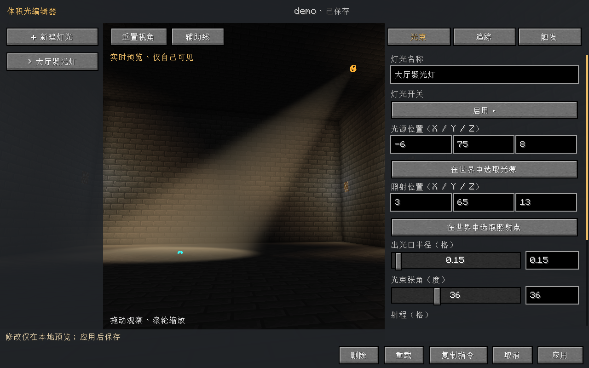
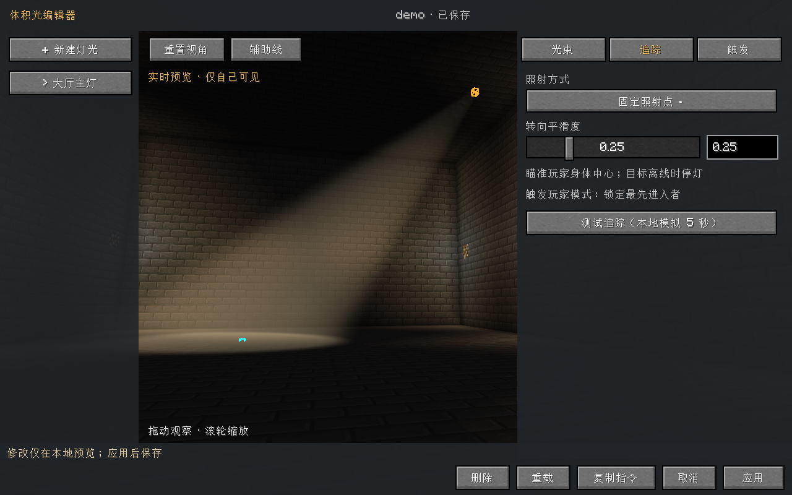
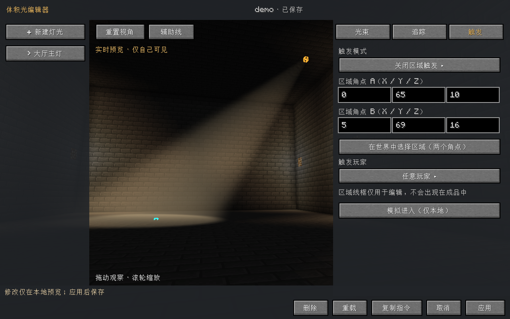
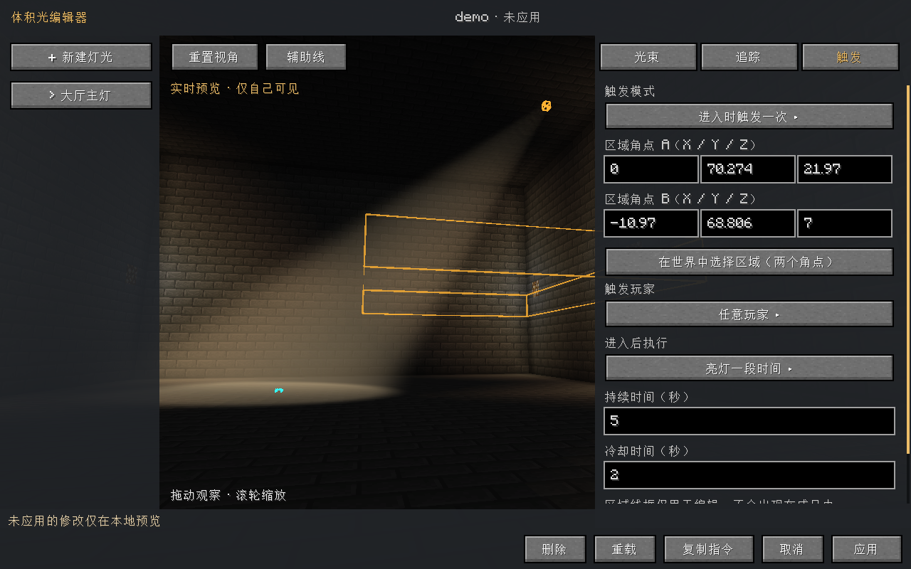
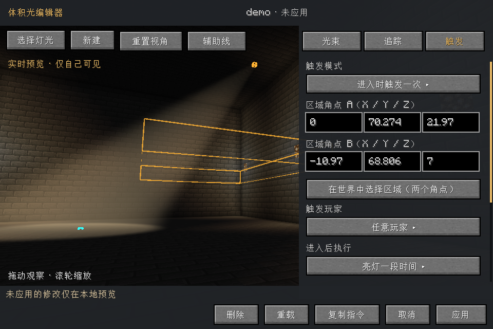
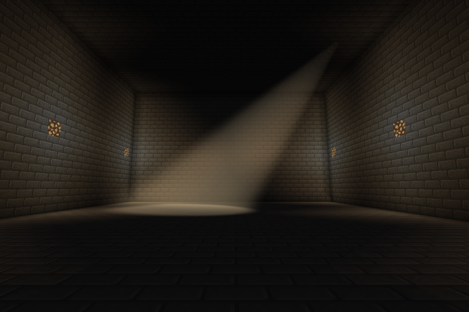
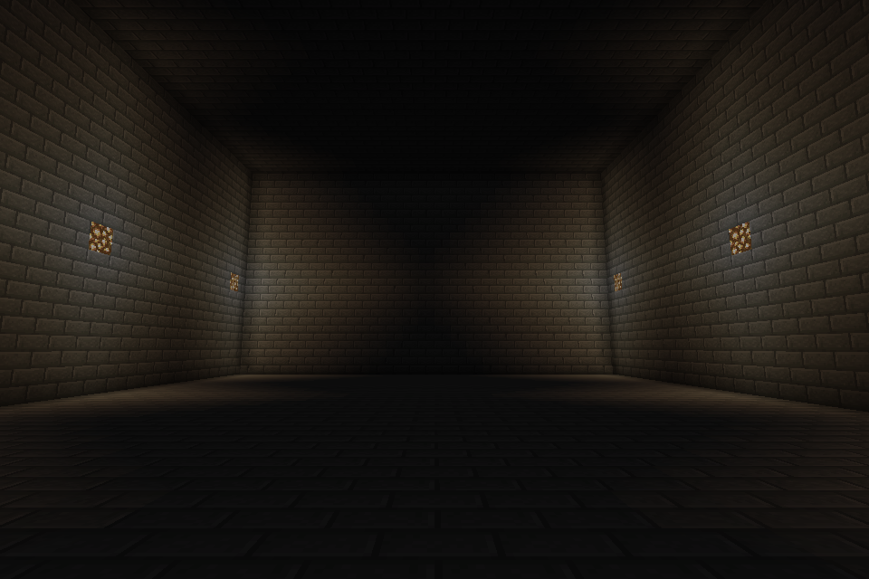

# 0.1.1 验证记录

日期：2026-11-06（Asia/Shanghai）。

- Minecraft Java 1.20.1，Forge 47.4.28，Java 17，Windows。
- 图形环境：NVIDIA GeForce RTX 4070 Ti SUPER，OpenGL 4.6。
- `gradlew build`：通过；包含 reobfJar，可用于普通 Forge 实例。
- `selfCheck`：参数边界、非法数值、NBT/指令导出往返、存档往返、进入边沿、冷却、最后一人离开、目标锁定、手动开启与区域自动化恢复、指令结构、位置同步包编解码均通过。
- `runClient -PpreviewUI`：通过，自动测试结束并正常保存测试世界退出。
- 实际命令执行：创建、位置、张角、射程、亮度、半径、区域框选、动作、持续时间、关闭区域、玩家选择器、取消追踪、开关和完整配置导入。
- 重复 `on` 不增加配置修订号；旧修订配置无法覆盖当前保存。
- UI 修改先保留本地草稿，“应用”经 C2S 请求保存并收到 S2C 确认；“取消”不改已保存配置。
- 主编辑器、追踪页、触发页及窄屏布局完成实际渲染和可见控件边界检查。
- 角点选取回归：第一角点后持续按住攻击键并重复发送交互事件，不会记录第二角点；第二次独立鼠标按下才记录另一个角点；右键取消恢复原来的两个角点。客户端输出 `VLIGHT_PICK_CHECK_PASSED`。
- 光束开 / 关截图比较：61,268 个像素的 RGB 增量大于 15，累计 RGB 增量 8,651,906；确认着色器产生可见画面。

## 实机截图

这些图片来自实际运行的 Minecraft 客户端，不是概念生成图。

## 尚未验证

未进行独立专用服务器与两台客户端的联机实测，未验证 Oculus/OptiFine/其他光影组合，也未做多灯 GPU 性能基准。
首版使用低分辨率方块遮挡图，不包含实体投影或透明材质透射；细节限制见 README。
